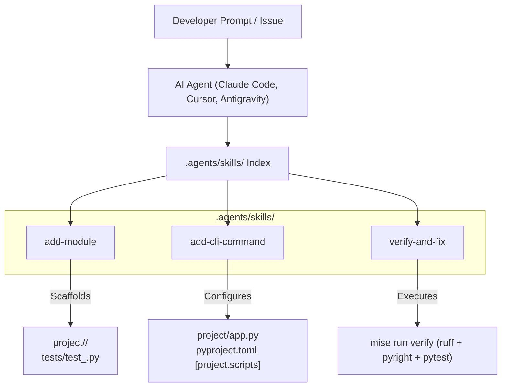

# Design: Agent Skills for cur8d Python

## Architecture Overview



## Directory Structure

Skills will be placed in `.agents/skills/` to ensure immediate compatibility with `skills.sh`, Claude Code, Cursor, and other agent platforms:

```text
python/
├── .agents/
│   └── skills/
│       ├── add-module/
│       │   └── SKILL.md
│       ├── add-cli-command/
│       │   └── SKILL.md
│       └── verify-and-fix/
│           └── SKILL.md
├── project/
├── tests/
├── pyproject.toml
└── mise.toml
```

## Skill Definitions

### 1. `add-module`
- **Frontmatter**:
  ```yaml
  ---
  name: add-module
  description: Scaffolds a new domain service, model, or utility module adhering to cur8d standards with type annotations, docstrings, and comprehensive pytest tests. Use whenever asked to add, create, or scaffold a module or service.
  category: coding
  tags: [python, uv, pyright, pytest, cur8d]
  ---
  ```
- **Rules**:
  - Full typing support (`pyright` strict typing without `Any` wherever possible).
  - Docstrings following Google/PEP 257 format.
  - Test suite in `tests/` verifying nominal cases, edge cases, and exception handling.

### 2. `add-cli-command`
- **Frontmatter**:
  ```yaml
  ---
  name: add-cli-command
  description: Adds a new CLI command or subcommand using Click with structured arguments, options, help text, and CliRunner tests. Use whenever asked to add or modify CLI commands.
  category: coding
  tags: [python, click, cli, cur8d]
  ---
  ```
- **Rules**:
  - Leverages Click decorators (`@click.command`, `@click.option`, `@click.argument`).
  - Registers entry points in `pyproject.toml` under `[project.scripts]`.
  - Scaffolds tests using `click.testing.CliRunner`.

### 3. `verify-and-fix`
- **Frontmatter**:
  ```yaml
  ---
  name: verify-and-fix
  description: Runs repository verification checks (ruff, pyright, pytest, coverage) and iteratively resolves errors and lint warnings. Use whenever asked to verify, check, or fix code quality or test issues.
  category: coding
  tags: [python, ruff, pyright, testing, cur8d]
  ---
  ```
- **Rules**:
  - Executes `mise run verify`.
  - Runs `uv run ruff check --fix` and `uv run ruff format`.
  - Reports status and preserves all existing docstrings and comments.
